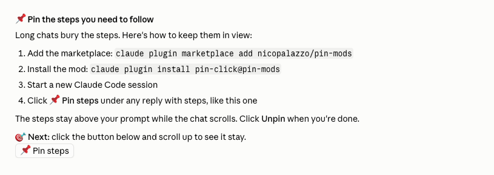
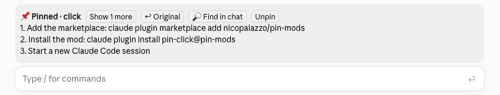

# pin-mods

I work with Claude Code on several projects at once. Claude often ends a reply with steps for me: run this, open that, check this. I'd start on step 1, ask a question, and three replies later the steps were gone. I scrolled up to find them, lost my place, and sometimes skipped one.

I wanted the steps to stay in front of me while the chat kept going. Claude Code didn't have that, so I built it.

One click keeps them above the prompt while the chat scrolls:

## How it went

- I tried Codex first. I got a working demo in a browser, but Codex had no safe place to add it, so it stayed a demo.
- Claude Code lets a mod draw above the prompt. On 9 Oct I built three versions: a command (`/pin`), a button under replies (pin-click), and a checklist Claude pins when you ask (pin-ask).
- The button is the one I use. A command is one more thing to remember; the button is just there.
- On 13 Oct the button was missing under a reply where Claude put the plan in a table. Now a table counts too, when the reply ends with a call to action.

Everything stays in your session, on your computer. Nothing is sent anywhere.

## Install pin-click

    claude plugin marketplace add nicopalazzo/pin-mods
    claude plugin install pin-click@pin-mods

Start a new session. The button appears under replies with a numbered or bulleted list, or with a table followed by a call to action ("Next", "Your turn", ❓, 🎯). In the band: "Original" shows the full reply; "Find in chat" copies a search phrase for the app's find (Cmd+F).

## Other ways to pin

| Mod | When to use it |
|---|---|
| `pin` | You prefer typing: `/pin` keeps the last reply's steps, `/pin your text` keeps your own |
| `pin-ask` | You want Claude to write the checklist: say "pin the steps", then tick lines off |

Only one band shows at a time. Unpin one before trying another.

## Known limits (tested 9 Oct 2026)

- The desktop app doesn't let a plugin scroll the chat, so "Find in chat" falls back to copying a phrase.
- The Claude iPhone app draws nothing from a plugin.
- Claude Code only; Codex has no equivalent screen.

## Check

    scripts/check.sh

Validates the marketplace and each mod, then runs their tests (needs the `claude` CLI). See [CONTRIBUTING.md](CONTRIBUTING.md).

## Licence

MIT. See [LICENSE](LICENSE).
